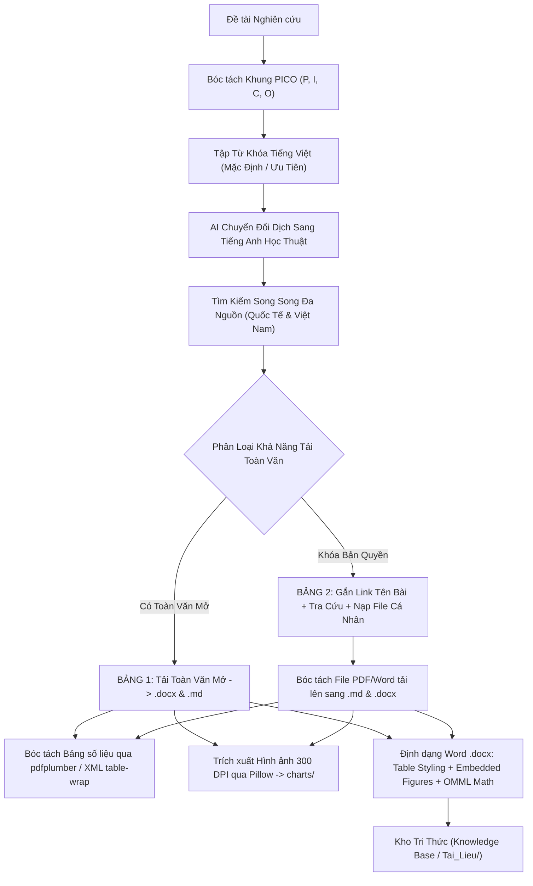

# SKILL AUTO HARVEST & HIGH-FIDELITY KNOWLEDGE INGESTION (.DOCX & .MD)

## I. TỔNG QUAN VÀ MỤC TIÊU
Skill này đảm nhiệm toàn bộ quy trình thu thập, bóc tách và chuyển đổi tài liệu khoa học đa nguồn sang định dạng Word (`.docx`) và Markdown (`.md`) với **độ toàn vẹn 100% (High-Fidelity Ingestion)**:
1. **Phân tích Đề tài theo Khung PICO & Bản thể học Học thuật**: Tự động bóc tách từ khóa đa tầng với **ưu tiên Tiếng Việt làm mặc định**, đồng thời dịch thuật học thuật chuyên sâu sang Tiếng Anh.
2. **Cơ Chế Tìm Kiếm Song Ngữ Tự Động (AI Dual-Language Bridging)**: Quét song song 5 cơ sở dữ liệu học thuật toàn cầu (Google Scholar, EuropePMC, arXiv, OpenAlex, CrossRef) và VJOL/Scholar Việt Nam.
3. **Bóc Tách Toàn Diện Đa Phương Thức (Multi-Modal Full-Text Extraction)**:
   - **Dữ liệu Toàn văn (Verbatim Text)**: Giữ nguyên văn toàn bộ nội dung IMRaD của tài liệu gốc, nối liền các dòng ngắt ngang và loại bỏ gạch nối ngắt từ (`hyphenation`).
   - **Bảng số liệu cấu trúc lưới (Structured Grid Tables)**: Bóc tách chính xác từng hàng, cột, tiêu đề bảng (`Bảng X: ...`) và chú thích chân bảng (`*Ghi chú: ...*`) từ EuropePMC XML và PDF (qua `pdfplumber`), chuyển thành bảng Word chuẩn in ấn.
   - **Hình ảnh, Sơ đồ, Biểu đồ Thực nghiệm (Authentic 300 DPI Figures)**: Tải và trích xuất hình ảnh gốc, chuẩn hóa chất lượng cao **300 DPI** qua `Pillow`, lưu vào `workspace/charts/` và tự động nhúng vào đúng vị trí phân mục tương ứng trong file `.docx` kèm Caption chuẩn học thuật.
   - **Công thức Toán học & Ký hiệu Hóa học**: Tự động chuẩn hóa công thức khối sang LaTeX/OMML và ký hiệu hóa học inline sang Unicode (`CO₂`, `NH₄⁺`, `FeS₂`, `H₂SO₄`, `Al³⁺`, `BOD₅`, `NO₃⁻`...).
   - **Danh mục Tài liệu Tham khảo Thực tế 100%**: Truy xuất trực tiếp từ XML bài báo hoặc CrossRef API theo mã DOI (Zero Fabrication).
4. **Phân Tách 2 Bảng Học Thuật Trực Quan**:
   - **Bảng 1 (Toàn văn mở)**: Tải và chuyển đổi hàng loạt sang `.docx` & `.md` hoàn chỉnh.
   - **Bảng 2 (Giới hạn bản quyền / Cần tự tra cứu)**: Gắn link trực tiếp vào tên bài báo, cung cấp các nút tra cứu Google Scholar ↗, trang nguồn DOI ↗, và nút **"📤 Nạp File PDF/Word (.md)"** để tự động bóc tách sang dữ liệu `.docx` & `.md`.

---

## II. QUY TRÌNH THỰC THI CHI TIẾT

---

## III. QUY CHUẨN ĐỊNH DẠNG TỆP WORD (.DOCX) & MARKDOWN (.MD)

### 1. Cấu trúc Tệp Word (.docx)
- **Tiêu đề & Metadata xuất bản**: Tên bài báo, Tác giả, Năm, Tạp chí, DOI, Mã trích dẫn Zotero, URL nguồn.
- **Tóm tắt (Abstract)**: Đoạn văn học thuật chuẩn mực, ngắt đoạn mạch lạc 2–4 câu.
- **Thân bài (Full Text IMRaD)**: Giữ nguyên cấu trúc các chương mục, tiểu mục phân cấp.
- **Bảng số liệu (Grid Tables)**:
  - Header nền Navy Blue (`#1E3A8A`), chữ trắng, in đậm, căn giữa.
  - Các dòng dữ liệu có nền sọc xen kẽ (`#F8FAFC`), căn lề trái hoặc phải cho số liệu, viền thanh nhã (`#CBD5E1`).
  - Bề rộng cột được tự động tính toán tỷ lệ cân đối theo nội dung thực tế trên khổ giấy A4.
- **Hình ảnh / Biểu đồ (Embedded Figures)**:
  - Độ phân giải chuẩn in ấn **300 DPI**, căn giữa trang in A4 (bề rộng 5.2 – 5.6 inches).
  - Caption bên dưới: *Times New Roman, 10.5pt, In nghiêng, Đậm, Căn giữa* (ví dụ: *Hình 2: Sơ đồ chu trình chuyển hóa nito trong đất ngập nước*).
- **Tài liệu tham khảo (References)**: Danh mục tài liệu trích dẫn thực tế của bài báo.

### 2. Thư mục và Định danh Tệp
- **Thư mục tài liệu**: `workspace/Tai_Lieu/`
- **Thư mục hình ảnh**: `workspace/charts/`
- **Quy tắc đặt tên tệp**:
  - File Word: `[Năm]_[TácGiả]_[TênRútGọn].docx`
  - File Markdown: `[Năm]_[TácGiả]_[TênRútGọn].md`
  - File Metadata: `workspace/Tai_Lieu/metadata.json`

---

## IV. BẢO VỆ ĐẠO ĐỨC HỌC THUẬT & 4 QUY TẮC BẤT BIẾN
1. **Evidence First & Zero Fabrication**: 100% dữ liệu, số liệu và trích dẫn được bóc tách nguyên bản từ nguồn khoa học xác thực, không bịa đặt số liệu/DOI.
2. **In-Place DOM Word (.docx) Preservation**: Bảo toàn toàn bộ cấu trúc bảng biểu, hình ảnh, mã trích dẫn Zotero và heading styles.
3. **Chuẩn hóa số thập phân tiếng Việt**: Dấu phẩy cho số thập phân (`1,5; 28,5%`) và dấu chấm cho hàng nghìn (`1.000; 50.000`).
4. **Chuẩn hóa công thức & ký hiệu**: Áp dụng bảng ánh xạ Unicode hóa học và OMML toán học chuẩn xác.
